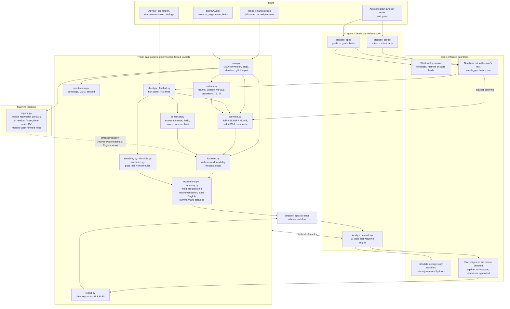

# Architecture

Gulf Portfolio Lab has three kinds of logic, and they are kept apart on purpose:

| Kind | What it is | Where |
|---|---|---|
| **Python calculations** | Deterministic, tested code. The same inputs always give the same numbers. | `src/gpl/*.py` (except `regime.py`), `app/` |
| **Machine learning** | One statistical model fitted to data: the market-regime classifier. | `src/gpl/regime.py` (scikit-learn) |
| **AI agent (LLM)** | Claude, through the Anthropic API. It reads, transcribes and explains, and never produces a number. | `src/gpl/agent/` |

## Diagram

Solid arrows carry data. The dotted arrow is optional: the regime forecast only feeds the
regime-aware backtest and the Regime view, never the recommendation.

## Python calculations

Everything that produces a number a client might rely on:

- **Data** (`data.py`, the only module that does I/O): adjusted prices, conversion to USD with
  the official GCC pegs, alignment of Sunday–Thursday and Monday–Friday calendars, repair of
  sub-unit glitches.
- **Measurement** (`metrics.py`): returns, volatility, Sharpe, drawdowns, VaR and expected
  shortfall, and benchmark measures such as tracking error, information ratio and hit rate.
- **Construction** (`optimise.py`, `construct.py`): constrained optimisation with SciPy;
  Ledoit-Wolf covariance shrinkage (a statistical estimator, not a learned model); the curated
  universe screen, the Build and Improve modes, swaps and the turnover limit.
- **Testing on history** (`backtest.py`, `montecarlo.py`): walk-forward backtests with no
  look-ahead and costs by market; seeded Monte Carlo simulation.
- **Adviser rules** (`client.py`, `factfind.py`, `suitability.py`, `domicile.py`,
  `scenarios.py`): the risk score, IPS limits, suitability checks, drift trades and domicile
  figures.
- **The decision** (`recommend.py`): a fixed rule per goal chooses the recommendation from
  walk-forward, after-cost results. A change needs a Sharpe gain of at least 0.05 (Improve) or an
  information ratio of at least 0.10 that beats the benchmark (Build), and must pass every IPS
  rule. Otherwise the rule keeps the current portfolio, falls back to a labelled next-best option
  (in Build, held to the same tests as every candidate, and never one another IPS-passing
  candidate beats on every measure), or shows the closest portfolio with its breaches.
- **The plain-English summary** (`summary.py`, `recommend.candidate_statuses`): the summary
  card ("what we did / found / recommend / what changes"), each candidate's status and reason,
  and the current-vs-recommended cards are assembled by code from the report's facts. They are
  not written by the AI.
- **Output** (`report.py`, `plots.py`, `agent/charts.py`): PDFs and charts drawn from engine data.

## Machine learning

`regime.py` is the only part that learns from data. It predicts whether the next 21 trading days
will be "stressed" (SPY volatility above the 80th percentile of its past year) from SPY, AGG and
VIX features.

- **Model:** logistic regression with feature scaling by default; a random forest is available
  in config.
- **Validation:** time-series cross-validation with a 21-day gap; monthly walk-forward refits that
  train only on labels already known on each date.
- **Benchmarking:** it is compared with a one-line "volatility is already high" rule, which does
  about as well (see the README).
- **Scope:** the forecast is shown in the Regime view, can drive a regime-aware backtest, and can be
  quoted by the analyst through `get_regime_view`. It does not feed the optimiser or the
  recommendation rule.

## The AI agent

The LLM is called in three places, each with a narrow job.

| Call | It does | It cannot |
|---|---|---|
| `agent/profile.py` `propose_profile` | Copies facts from the adviser's notes into the client form (name, age, dated cash needs, tax notes, region minimums). | Fill in the risk questionnaire, scores or IPS limits. Any number not in the notes is flagged, and code (not the AI) turns "in 18 months" into a date. |
| `agent/spec.py` `propose_spec` | Turns plain-English goals into one of five goals, a target and limits, as written. | Choose weights or a method: the strict schema has no such fields. The adviser confirms the spec before anything runs. |
| `agent/analyst.py` `Analyst` | Writes the memo: decides which of the 17 tools to call, which charts to show (from a fixed list) and how to explain the results. | Calculate, change a chart's data, or recommend anything the rule did not choose. |

### What the agent is allowed to do

- **Call tools that wrap the engine:**
  - data and metrics: `get_universe`, `get_asset_metrics`, `get_my_portfolio`;
  - analysis: `optimise_portfolio`, `backtest_strategies`, `simulate_future`,
    `get_portfolio_diagnosis`, `get_optimisation_result`, `what_if_portfolio`, `stress_test`,
    `get_regime_view`;
  - adviser checks: `check_suitability`, `check_domicile`, `get_drift_and_trades`,
    `get_client_profile`;
  - output: `show_chart` and `calculate`.
- **Choose a chart type and its section** with `show_chart`. The schema has no numeric fields,
  and code computes and draws the chart.
- **Run a what-if** with `what_if_portfolio`, but only with weights the user wrote in their own
  message. The other holdings are scaled pro-rata by code.
- **Do arithmetic through `calculate`** (sums, differences, shares), on numbers already returned
  by a tool or written by the user.
- **Explain**: the rule's choice, its trade-offs, each swap's reason and each suitability result,
  in plain language, citing the tool behind every figure.

### What the agent is not allowed to do, and how code enforces it

| Not allowed | Enforced by |
|---|---|
| Produce or estimate a number | `analyst.unverified_numbers` compares every decimal, percentage and multiple in the memo with the tool outputs, and flags any that don't match (a re-rounded "15.3%" for "15.27%" is flagged). |
| Do arithmetic in its head | `tools.calculate` refuses any input that did not come from a tool result or the user's message. |
| Choose weights or an optimisation method | `propose_spec` has a strict schema with no weight or method fields, and the user confirms the spec. |
| Choose the recommendation | `recommend.py` applies a fixed, tested rule; the agent can only read it with `get_optimisation_result`. |
| Call a failing portfolio suitable | Only portfolios that pass every suitability rule can be recommended; otherwise `closest_fails` shows each breach. |
| Set the risk score or IPS limits | `client.py` scores the questionnaire and sets the limits; `propose_profile`'s schema excludes them. |
| Invent chart data | `agent/charts.py` computes each chart from the engine, and tests check that the AI's text cannot change one. |
| Promise returns | The prompt forbids it; results are labelled historical, and code appends the "not investment advice" disclaimer. |

Every tool call is listed in an audit trail under the memo. The model ID is set in
`config/universe.yaml` (Claude Haiku 5.5 by default), and the API key is read from `.env` or
Streamlit secrets and never committed.

## Request flow: one Optimise run

1. The adviser completes the fact-find. `client.py` scores the risk questionnaire and builds the
   IPS limits.
2. The adviser picks a goal, or types one for `propose_spec` to transcribe, and confirms it.
3. `construct.py` and `optimise.py` build the candidates, and `backtest.py` re-estimates each one
   at every rebalance using past data only, after costs.
4. `suitability.py` checks each candidate against the IPS, and `recommend.py` applies the fixed
   rule.
5. The adviser can optionally ask the analyst to explain the result. It calls
   `get_optimisation_result` and other tools, and code checks every figure in the memo.
6. `report.py` writes the client report PDF from the rule's choice, never from a chat what-if.
