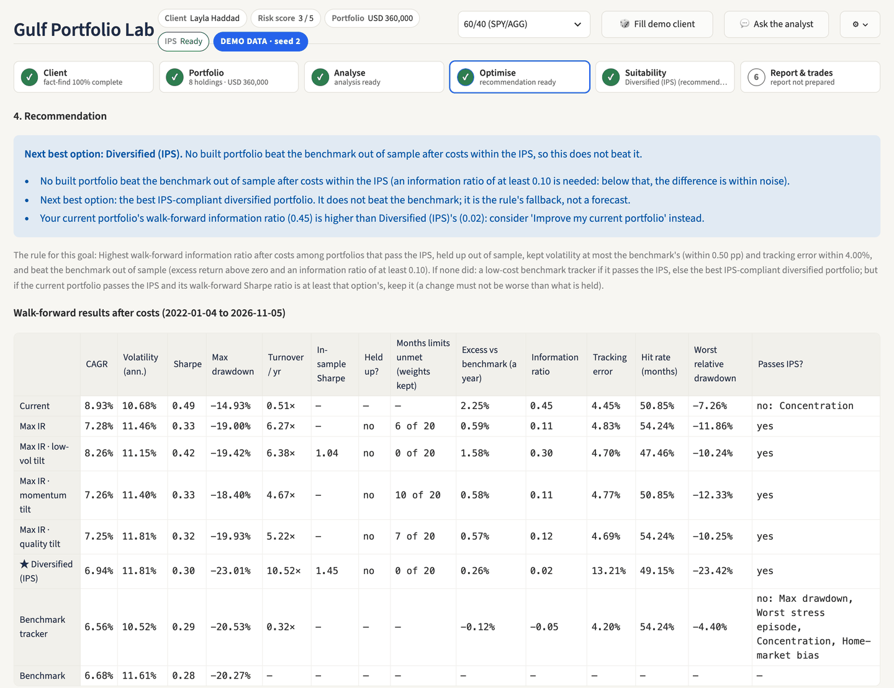
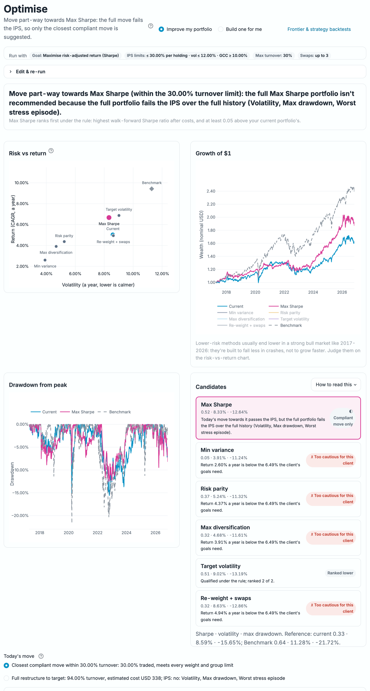
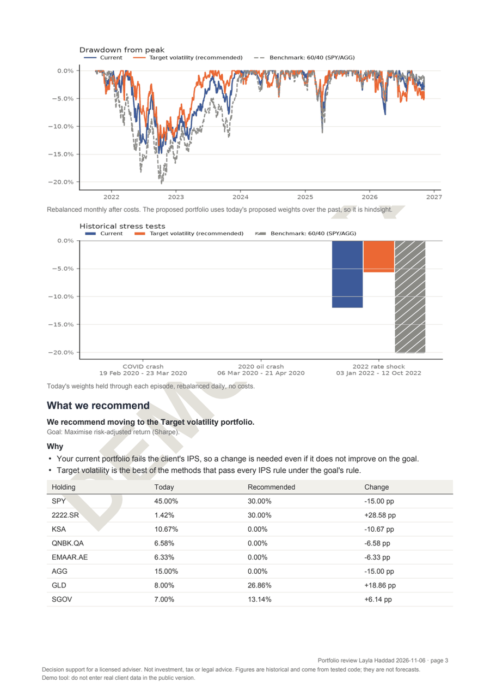

# Gulf Portfolio Lab

[](https://github.com/omarnaser16/gulf-portfolio-lab/actions/workflows/tests.yml)

**Portfolio construction and suitability for GCC wealth managers: tested Python does every
calculation and makes every recommendation; the AI only writes an optional explanation of it.**

🔗 **Live demo:** LIVE_URL · 🧭 **How it fits together:** [ARCHITECTURE.md](ARCHITECTURE.md) ·
📄 **Full methodology and limitations:** [docs/METHODOLOGY.md](docs/METHODOLOGY.md)

> **Not investment advice.** An educational portfolio project and decision support for a licensed
> adviser. Past performance does not predict future results. **Do not enter real client data in
> the public demo.**

## Screenshots

All three come from the app with **▶ Try a demo client** (seed 2, 8 Nov 2026): a fictional
client whose portfolio fits their IPS, marked DEMO DATA everywhere.

**Build a portfolio for me:** the settings of the run, a one-sentence answer, risk against
return for every candidate, growth of $1 and drawdowns (current, benchmark and the pick), and
each candidate's status with its reason. Here no build beats 60/40 reliably, so the rule's
fallback, Diversified (IPS), is shown as the next best option, not as a forecast.



**Improve my current portfolio:** Max Sharpe beat the current portfolio's walk-forward Sharpe
ratio after costs by 0.19 (0.52 against 0.33), with lower volatility and a shallower largest
fall, so the rule picks it. But the full Max Sharpe portfolio fails the client's IPS over the
full history (volatility, maximum drawdown and the worst stress episode), so it is not
labelled recommended: only the closest compliant move towards it, within the 30% turnover
limit, is suggested, and the page says why.



**Client report (PDF), page 3:** drawdowns, stress tests and the recommendation in plain language.



## What it does

1. **Build a portfolio for me.** From a curated universe of 62 tagged securities (global and GCC
   ETFs, GCC blue chips when the IPS asks, bonds, sukuk, gold, cash, factor and Sharia funds),
   screened by the client's IPS, it builds 8-15-holding candidates that maximise the information
   ratio against the benchmark, within a 4% tracking-error limit and the benchmark's volatility,
   with optional low-volatility, momentum or quality tilts. Securities and weights are re-chosen
   every quarter using only data available then, after costs, trading at most 25% a quarter. A
   fixed rule recommends a build only if it beat the benchmark out of sample (information ratio at
   least 0.10). Otherwise it shows a clearly labelled next best option, held to the same tests as
   every candidate and never one another candidate beats on every measure, or says to keep the
   current portfolio. Build also suggests a policy benchmark that itself fits the IPS.
2. **Improve my current portfolio.** Five re-weighting methods (max Sharpe, min variance, risk
   parity, max diversification, target volatility) plus up to three rule-based swaps, each with
   its reason, under a 30% turnover limit. If the current portfolio breaks the IPS, the default
   is the closest compliant move within that limit, and the adviser can choose a full
   restructure instead, shown with its turnover and cost. It recommends a change only if it
   passes the IPS and
   beats the current portfolio's walk-forward Sharpe ratio by at least 0.05. UCITS domicile ideas
   are shown separately, as information, not tax advice.
3. **A wealth manager's workflow in six steps.** It runs from Client to Portfolio, Analyse,
   Optimise, Suitability, then Report & trades:
   - **Fact-find:** nine sections, with a completeness bar.
   - **Risk score and IPS:** a risk questionnaire scored by a tested rule, and an Investment
     Policy Statement (PDF, DRAFT until the fact-find is complete).
   - **Suitability:** ten rules (volatility, drawdown, stress, concentration, home bias, region
     minimums, liquidity, exclusions, currency, knowledge & experience), each pass, fail or
     review with its reason.
   - **Trades:** a cash-neutral trade list with costs per market.
   - **Client report:** a PDF with an adviser sign-off block.

## Key findings

- **A decade favoured simple portfolios.** Sep 2016 – Sep 2026, after costs: SPY had a Sharpe
  ratio of 0.75 and 60/40 had 0.67. Max Sharpe had 0.59, risk parity 0.38 and min variance 0.30.
  The diversified strategies had smaller drawdowns (min variance −15.21% vs SPY −33.72%) but lower
  returns.
- **The machine-learning regime model is no better than a one-line rule.** Predicting stressed
  months out of sample (Jul 2009 – Aug 2026), logistic regression reached a ROC AUC of 0.72, and
  "volatility is already high" reached 0.71 with higher precision and accuracy. De-risking on
  the forecast cut the equal-weight COVID drawdown from −20.32% to −16.06%, but lowered its
  Sharpe ratio from 0.49 to 0.39.
- **Build beat the IPS-fitting benchmark only after the fixes, and lost to 60/40.** For the
  Dubai example (live run, 8 Nov 2026, 39 quarters re-selected, after costs):
  - Against 60/40 no build reached an information ratio of 0.10. The next best (the low-vol
    tilt, Sharpe ratio 0.55) was worse than the client's current portfolio (0.67), which passes
    the IPS, so the rule keeps it.
  - Against the policy benchmark (ACWI alone, the first change) with the 25%-a-quarter turnover
    limit (the second), the quality tilt is recommended: information ratio 0.21, 0.67% a year
    above the benchmark, tracking error 3.02%.
  - On 6 Nov, with ACWI plus URTH and no turnover limit, no build reached 0.10. With ACWI alone
    but no limit, the low-vol tilt reaches 0.13; the limit cut trading from 2.6–3.1× a year to
    under 1× and lifted most builds. The changes came from a test finding, not from chasing
    this number, but a better result after changing the method is still a mild form of
    hindsight, and the margins are small.
- **Improve found a modest, rule-qualifying gain.** For the same client, target volatility
  improved the walk-forward Sharpe ratio from 0.66 to 0.73, passing every IPS rule within the 30%
  turnover limit. It is historical and risk-adjusted, not a forecast.
- **A calendar bug, found and pinned by a test.** Comparing a US-calendar benchmark with a
  universe that includes Gulf stocks (fewer common trading dates) inflated tracking error: SPY
  against 60/40 showed 10.98% instead of 7.04%, and Max IR failed the limits in 36 of 39 quarters.
  After compounding returns onto common dates it fails in 0, and a regression test guards it.

Detailed tables are in [docs/METHODOLOGY.md](docs/METHODOLOGY.md#key-results).

## Main limitations

1. **Decision support, not advice.** The risk bands and thresholds (0.10 information ratio, 0.05
   Sharpe gain) are judgement defaults, not calibrated to client outcomes. Sharia status comes
   from a partial list, and anything unknown is "review".
2. **One sample, with survivorship.** About ten years dominated by US equities. The universe is
   today's funds, so funds that closed are missing.
3. **History-based estimates.** Expected returns are noisy historical means. Picking the best of
   several candidates on the same period is a mild form of hindsight.
4. **Short and sparse data.** GCC, Sharia (from 2019) and UCITS funds have short histories, and
   mixing Sunday–Thursday and Monday–Friday markets leaves about 180-200 common dates a year.
5. **Simple costs, unofficial data.** Flat per-market costs (GCC rates are estimates), no market
   impact or taxes. Prices come from `yfinance`, which is unofficial.
6. **AI checks have gaps.** The number check covers decimals, percentages and multiples, not bare
   integers or numbers written in words, and the model can still mis-describe a correct number.

Every limitation, in detail: [docs/METHODOLOGY.md](docs/METHODOLOGY.md#limitations).

## How the AI is constrained

This is not a chatbot. The LLM (Claude, via the Anthropic API) has one job: after Optimise has
chosen a recommendation by its fixed rule, the adviser can press **Explain this recommendation
(AI)** for a short plain-English memo, which is added to the client report.
- **No text from the user reaches it:** the app sends one fixed request; there is no chat box,
  no "describe your goals" box and no free-text field anywhere.
- **Tools for figures:** it reads the results through 16 tools that wrap the engine; it never
  calculates, chooses weights or picks the recommendation.
- **Checked by code:** every figure in the memo is compared with the tool outputs, and the
  disclaimer is appended by code. Without an API key the app works fully and shows a note. See
  [ARCHITECTURE.md](ARCHITECTURE.md).

## How this was built

**The code in this repository was written by [Claude Code](https://claude.com/claude-code),
Anthropic's coding agent**, over a series of sessions. My role (Omar Naser) was to **direct,
review and test**:

- **Directed:** I defined the idea, scope, stack and plan ([docs/BRIEF.md](docs/BRIEF.md),
  drafted with Claude from my requirements) and set each session's priorities. I approved every
  dependency and chose between the options presented: the 40% risk-parity cap, the fixed end
  date, block bootstrap, the 0.05 Sharpe and 0.10 information-ratio thresholds, the 4%
  tracking-error and 30% turnover limits, and GCC blue chips only when the IPS asks. I set the
  rules that the AI only explains, and that a coded rule, not the AI, makes every
  recommendation.
- **Phases:**
  1. The finance core: data, metrics, optimisation, backtests, Monte Carlo.
  2. The ML regime model and the dashboard.
  3. The AI explanation (since narrowed to one memo: no chat).
  4. Real-investor features: any asset, GCC currencies, mixed calendars.
  5. The wealth-manager workflow: client, IPS, suitability, domicile, trades, report.
  6. A professional upgrade: full fact-find, the six-step workflow, light theme, *Fill demo
     client*.
  7. The two Optimise modes, Build and Improve, with the policy benchmark.
  8. Fixing the mixed-calendar bug above.
- **Reviewed:** I read the results, notebooks and explanations, and asked for changes where
  something looked wrong. For example, I checked whether the regime probabilities were calibrated,
  led with ROC AUC instead of accuracy, and stated limitations such as the 2022 whipsaw.
- **Tested, including an AI-driven end-to-end walkthrough:** I set up a separate AI agent (Claude
  in Chrome) to role-play a GCC wealth manager. It invented a client, used the live app only
  through the browser, and reported the bugs it hit. I reviewed its report and had the fixes made
  in two batches (a six-part fix, then a nine-fix QA batch). This was an AI-driven test I set up
  and acted on, not a human or independent review. I also used the app myself and reported
  problems, such as a weight-cap violation and inconsistent formats.

Claude Code worked in a "build and explain" mode ([.claude/CLAUDE.md](.claude/CLAUDE.md)): after
each function it explained the finance idea, and after each module it asked me interview-style
questions. [docs/PROGRESS.md](docs/PROGRESS.md) is the session-by-session log, including mistakes
found and fixed.

## Future work

- Smoothing rules for the regime switch (two months above the threshold, or a hysteresis band),
  chosen on 2008–2018 only and tested once on 2019–2026.
- GCC-specific stress features (oil, local market volatility).
- Verified Sharia screening from a recognised data provider (AAOIFI-style financial ratios) in
  place of the curated list.
- Black-Litterman with a GCC view; CVaR optimisation.
- An evaluation set for the analyst (does every memo cite every number?).

## Run it locally

```bash
git clone https://github.com/omarnaser16/gulf-portfolio-lab.git && cd gulf-portfolio-lab
python3.14 -m venv .venv && source .venv/bin/activate
pip install -e ".[dev]"
cp .env.example .env            # then add your ANTHROPIC_API_KEY (only needed for the AI features)
pytest -q                       # 1043 tests, no network needed (live AI tests skip without a key)
streamlit run app/streamlit_app.py
```

**Deploying (Streamlit Community Cloud):** main file `app/streamlit_app.py`; `requirements.txt`
installs the package normally (not editable), and the code finds `config/` and `data/cache/`
from the working directory (the repository root). Elsewhere, set `GPL_PROJECT_ROOT` to the
repository folder. Put `ANTHROPIC_API_KEY` in the app's secrets.

Notebooks with the fixed-sample results: `notebooks/01_week1_results.ipynb` and
`notebooks/02_week2_regime.ipynb`.

## Project layout

```
ARCHITECTURE.md                what is calculation, what is ML, what the AI may and may not do
config/universe.yaml           tickers, groups, defaults, IPS bands, Optimise limits, agent settings
config/investable_universe.yaml  the curated Build universe (62 tagged securities)
config/investable_history.yaml   first price dates, written by scripts/verify_universe.py
src/gpl/data.py                download, cache, USD conversion, calendars (all I/O lives here)
src/gpl/metrics.py             risk, performance and benchmark-relative metrics
src/gpl/optimise.py            constrained optimiser (incl. max information ratio), Ledoit-Wolf
src/gpl/construct.py           universe screen, Build candidates, swaps, turnover limit, policy benchmark
src/gpl/backtest.py            walk-forward backtester with costs per market
src/gpl/recommend.py           the fixed recommendation rules (Improve and Build), candidate statuses
src/gpl/summary.py             the plain-English summary card, written by code from the report
src/gpl/client.py              client profile, risk questionnaire, IPS, IPS -> optimiser limits
src/gpl/factfind.py            fact-find sections, completeness, required return, review date
src/gpl/suitability.py         ten pass/fail/review rules against the IPS
src/gpl/scenarios.py           stress episodes, exposures, drift and trade list
src/gpl/domicile.py            US-situs check, illustrative US estate tax, UCITS alternatives
src/gpl/demo.py                seeded demo client and portfolio that fits its IPS (no AI)
src/gpl/report.py              IPS and client report PDFs
src/gpl/montecarlo.py          simulations, goal probability, path drawdowns
src/gpl/regime.py              the ML regime model: labels, features, models, walk-forward
src/gpl/plots.py               plotly charts (gpl_light template)
src/gpl/agent/                 tools.py (16 tools wrapping gpl), analyst.py (tool-use loop, number
                               check), spec.py (the Optimise form -> limits, no AI), charts.py
                               (charts built from engine data)
app/                           Streamlit app: streamlit_app.py, layout.py (six steps, header),
                               client_ui.py, workstation.py, inputs.py, formatting.py,
                               freshness.py (fresh modules after a deploy)
.streamlit/config.toml         light theme
scripts/verify_universe.py     checks every universe ticker on Yahoo Finance
tests/                         pytest suite (run by .github/workflows/tests.yml)
docs/                          METHODOLOGY.md, BRIEF.md, PROGRESS.md, screenshots/
.claude/CLAUDE.md              instructions Claude Code followed (build + explain mode)
```

## Licence and disclaimer

Educational project. Nothing here is investment, tax or legal advice, or a recommendation to buy
or sell any security. **Do not enter real client data in the public demo.** Data © its providers,
via Yahoo Finance.
